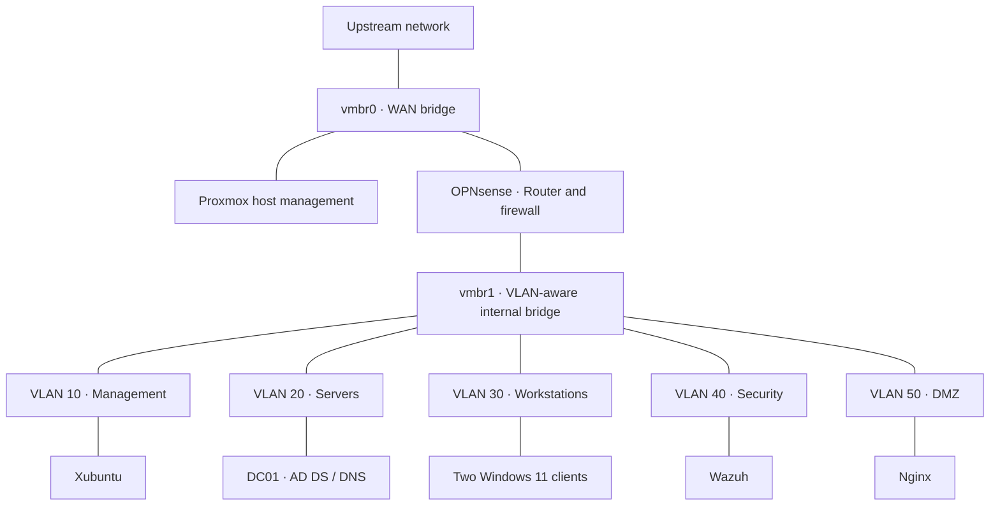

# Proxmox Cybersecurity Homelab

A segmented Windows and Linux lab built to develop practical security operations skills through controlled testing, investigation and troubleshooting.

**Operational baseline: 7 virtual machines across 5 VLANs.**

## Architecture

Proxmox VE hosts the environment. OPNsense provides routing, firewall controls and outbound connectivity through a VLAN-aware internal bridge.

*Lines show network attachment. Inter-VLAN access is controlled by OPNsense firewall policy.*

| VLAN | Zone | Subnet | Workloads |
|---|---|---|---|
| 10 | Management | 10.10.10.0/24 | Xubuntu administration workstation |
| 20 | Servers | 10.10.20.0/24 | Windows Server 2025 — AD DS and DNS |
| 30 | Workstations | 10.10.30.0/24 | Two domain-joined Windows 11 clients |
| 40 | Security | 10.10.40.0/24 | Wazuh manager, indexer and dashboard |
| 50 | DMZ | 10.10.50.0/24 | Ubuntu Server running Nginx |

OPNsense controls routed traffic between zones through service-specific firewall exceptions. The web service is internal, with no public port forward.

VLAN 10 contains the administration workstation. Proxmox host management remains on the upstream network, protected by host firewall controls and accessed remotely through Tailscale.

## Key Results

- Migrated the original flat network into five functional VLANs.
- Established Active Directory, DNS and two domain-joined workstations.
- Connected three Windows and two Linux endpoints to Wazuh.
- Validated selected domain services, internal web access and network restrictions.
- Restored persistent management connectivity after investigating firewall rule order and conflicting Netplan configuration.
- Created seven VM backups, a Proxmox configuration backup and an OPNsense export.

## Validation Boundaries

Five active Wazuh agents were recorded at the final checkpoint. Specific Nginx and Sysmon ingestion, along with attack detection coverage, still require validation.

Backup archives passed compression integrity checks. An isolated VM restore has not yet been tested.

## Documentation

| Document | Contents |
|---|---|
| [Infrastructure Architecture](docs/architecture.md) | Components, design decisions and constraints |
| [Network Design](docs/network-design.md) | VLANs, addressing, routing, DNS and DHCP |
| [Firewall Configuration](docs/firewall-configuration.md) | Required traffic flows and policy structure |
| [Validation](docs/validation.md) | Recorded results and outstanding checks |
| [Troubleshooting](docs/troubleshooting.md) | DNS and management network investigations |

## Next Steps

- Validate a controlled event from its source through to Wazuh.
- Perform an isolated restore and verify service recovery.
- Develop investigation case studies that reference this infrastructure.
