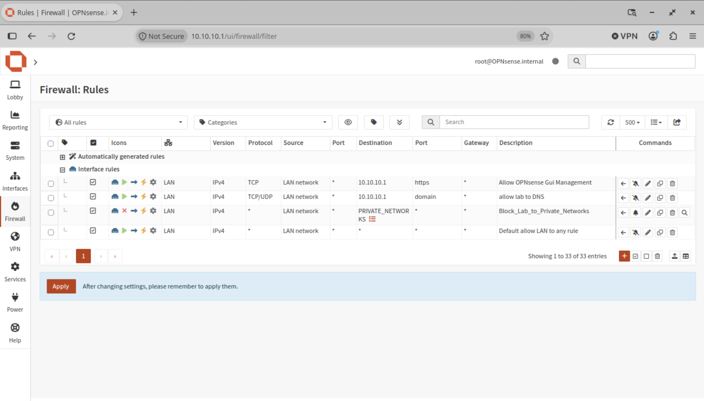

# Firewall Configuration

## Overview

OPNsense acts as the central firewall and router for the homelab. It controls traffic between the WAN interface and the isolated lab network.

## Firewall Objectives

- Restrict access between network segments.
- Protect the Proxmox management interface.
- Allow controlled outbound internet connectivity.
- Prevent unauthorized access to private network ranges.

## LAN Firewall Rules

The following rules are configured on the LAN interface:

| Rule | Source | Destination | Action |
|---|---|---|---|
| Allow OPNsense GUI Management | LAN network | 10.10.10.1:HTTPS | Allow |
| Allow lab to DNS | LAN network | 10.10.10.1:DNS | Allow |
| Block Lab to Private Networks | LAN network | PRIVATE_NETWORKS | Block |
| Default allow LAN to any rule | LAN network | Any | Allow |

Rules are processed from top to bottom. The block rule prevents lab systems from accessing restricted private network ranges before traffic reaches the default allow rule.

### Screenshot

## Network Protection

Access to the Proxmox management interface (TCP/8006) is restricted from the isolated lab network.

## NAT Configuration

Outbound NAT provides internet connectivity for systems within the isolated lab network.

## Validation

Firewall behavior is validated through:

- Connectivity tests.
- DNS resolution tests.
- Port access checks.
- Firewall log inspection.

## Future Improvements

- Review and refine firewall rules.
- Expand network monitoring and logging.
- Document additional security controls.
