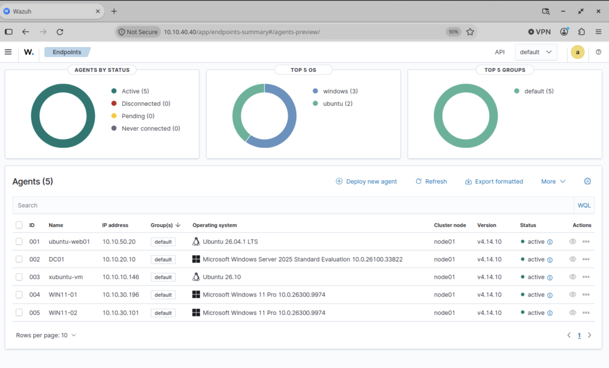

# Validation

[Back to project overview](../README.md)

This page summarizes validation recorded during the build and migration. Results describe the environment at those checkpoints.

## Infrastructure and Services

| Area | Recorded result | Scope |
|---|---|---|
| VLAN switching | VLAN-aware bridging enabled and workloads migrated into five zones | Network placement and selected connectivity checks |
| Active Directory | DC01 DNS resolution and selected domain controller diagnostics passed | Connectivity, Advertising and Services checks |
| Domain clients | Domain discovery, secure-channel recovery and Group Policy processing recorded for WIN11-01; migration completion confirmed for WIN11-02 | Selected domain functions |
| Internal web service | HTTP 200 received from a workstation after Web01 moved to the DMZ | Workstation-to-web-server application path |
| Firewall restrictions | Selected connections to private destinations blocked | Tested paths; a complete final flow matrix is not retained |
| Management networking | Static addressing, default route and dashboard access worked after correction and reboot | Persistence of the management configuration |

## Security Monitoring

Five Wazuh agents were active at the final checkpoint:

- DC01
- WIN11-01
- WIN11-02
- Xubuntu management workstation
- Ubuntu web server

Earlier build checkpoints recorded representative endpoint telemetry across all five agents. After migration, agent connectivity was confirmed again.

Agent status establishes connectivity. Each specific log source and detection requires its own end-to-end validation.

### Agent Connectivity Checkpoint — 27 November 2026

All five lab agents are active, with zero disconnected, pending or never-connected agents. The displayed addresses align with the segmented network design.

This checkpoint confirms agent connectivity at capture time. Specific log ingestion and detection behavior require separate validation.

## Backup Checks

| Item | Recorded check | Limitation |
|---|---|---|
| Seven VM archives | Passed `zstd -t` | Compression integrity; no VM restore performed |
| Proxmox configuration archive | Passed `gzip -t` | Archive integrity; host recovery not demonstrated |
| OPNsense configuration | Export downloaded | Off-host copy and recovery from this export not independently confirmed |

VM backups were created on 22 November, before the final management persistence correction on 23 November. Updated backups of changed systems are needed for a current recovery baseline.

## Open Validation Items

| Item | Evidence needed |
|---|---|
| Nginx ingestion | Correlate a controlled request with its local access-log entry and corresponding Wazuh record |
| Sysmon ingestion | Identify a known endpoint event and its matching Wazuh record |
| Detection behavior | Define test activity, expected detection and observed result, including a negative control |
| Final firewall policy | Pair applied rules with allowed and denied connection tests and matching firewall logs |
| IPv6 isolation | Establish the IPv6 configuration and test the intended restrictions |
| Recovery | Restore a VM in isolation and verify its required services |

## Evidence Scope

This summary is based on retained build notes and completion confirmations. Selected screenshots and outputs will be added to support the documented checkpoints.

No complete detection coverage, exhaustive network isolation test or successful disaster recovery exercise is claimed.
